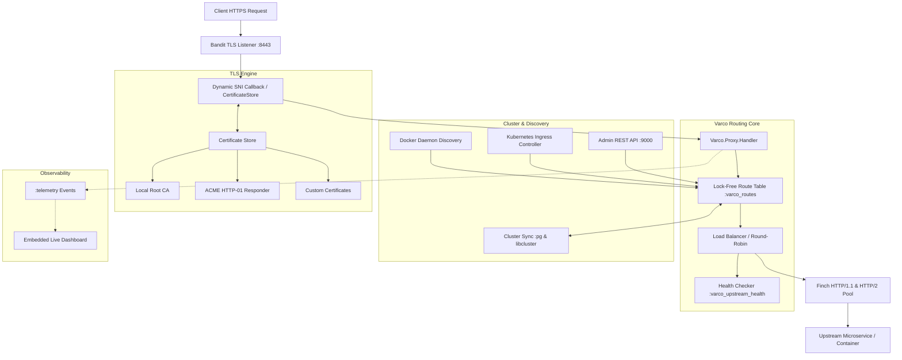

# Varco

> **A Next-Generation Reverse Proxy & Ingress Controller Powered by the BEAM**

```
 __      __                                
 \ \    / /                                
  \ \  / /_ _ _ __ ___ ___                 
   \ \/ / _` | '__/ __/ _ \                
    \  / (_| | | | (_| (_) |               
     \/ \__,_|_|  \___\___/  REVERSE PROXY 
```

**Varco** (*Italian for "gateway" or "passage"*) is a modern, high-performance reverse proxy, load balancer, and Kubernetes ingress controller written in Elixir. It is engineered to challenge tools like **Traefik** and **Caddy** by exploiting the superpowers of the **BEAM virtual machine**: massive fault isolation, lock-free routing lookups, transparent cluster distribution, and real-time observability.

---

## Why Varco?

### The Problem with Traefik and Caddy
* **Traefik** is notoriously difficult for newcomers. Its configuration model is fragmented into *EntryPoints*, *Routers*, *Middlewares*, and *Services*, forcing users to write dozens of verbose labels for a single container. Worse, **cluster-wide Let's Encrypt coordination was removed from Traefik CE** and locked behind an enterprise paywall.
* **Caddy** is user-friendly and fast, but scaling across a fleet requires external coordination plugins or shared storage for certificates and dynamic configurations.

### The Varco Advantage
| Capability | Traefik (CE) | Caddy | **Varco (Elixir / BEAM)** |
| :--- | :--- | :--- | :--- |
| **Cluster State Sync** | ❌ (Enterprise Only) | ⚠️ (Requires external plugin/Consul) | **Native BEAM Distribution** (`libcluster`, `:pg`) |
| **Distributed ACME** | ❌ (Paywalled) | ❌ | **Native:** Any node answers challenges for peers |
| **Zero-Config TLS** | Manual ACME setup | Auto Let's Encrypt / Local | **Auto Self-Signed Root CA** + ACME + Custom |
| **Dynamic Routing** | YAML / Ingress / Labels | Caddyfile / JSON API | **Zero-lock ETS / persistent memory + REST API** |
| **Fault Isolation** | Process-level panic | Process-level panic | **Supervision Trees:** Crashes isolate per request |
| **Live Dashboard** | Static React UI + Polling | None (CLI / Third-party) | **Embedded Real-Time Dashboard** (Zero dependencies) |

---

## Key Features

1. **Zero-Touch HTTPS Out of the Box**
   - Endpoints are automatically secured with TLS using an in-memory, cryptographic **Local Root CA**.
   - Developers can export the CA (`GET /api/v1/certificates/ca`) and install it into macOS Keychain, Windows Certificate Store, or Linux trust store once for green locks locally.
   - Production Let's Encrypt / ACME HTTP-01 challenge support built directly into the proxy pipeline.
   - Seamless upload and hot-reloading of custom wildcard or commercial certificates.

2. **Ultra-Low Latency Routing Engine**
   - Request routing table stored in lock-free ETS tables with `read_concurrency: true`.
   - Host matching (exact & wildcards like `*.example.com`) and longest-prefix path matching in sub-microsecond time.
   - Zero memory buffering: response bodies and large files stream directly to clients via `Finch` / `Mint` HTTP/1.1 and HTTP/2 pools.

3. **Convention over Configuration (Service Discovery)**
   - **Docker / Podman:** Requires only **one label** (`varco.host=api.example.com`). Automatically detects exposed ports and container bridge IPs.
   - **Kubernetes Ingress:** Fully native Ingress Controller for `ingressClassName: varco`.
   - **Static Configuration:** Declarative `varco.yaml` or `varco.json` with hot reload.

4. **Native BEAM Clustering**
   - Form clusters instantly across Kubernetes pods, Docker nodes, or bare-metal servers using `libcluster`.
   - Route modifications made on any node instantly propagate to all peers.
   - **Cluster-wide ACME Challenge Coordination:** When Node 1 requests an SSL cert from Let's Encrypt, any Node 2 or 3 that receives the validation request answers it immediately from synchronized memory!

5. **Declarative REST API & Embedded Real-Time Dashboard**
   - Manage all routes, certificates, upstreams, and cluster status at runtime via `/api/v1/*`.
   - Embedded, single-page dark dashboard accessible at `/dashboard` with zero npm/webpack dependencies.

---

## Architecture



---

## Quickstart

### 1. Run Prebuilt OCI Container (Recommended)
Run Varco instantly with Docker or Podman without installing Elixir:
```bash
docker run -d --name varco \
  -p 80:8080 -p 443:8443 -p 9000:9000 \
  -v /var/run/docker.sock:/var/run/docker.sock \
  ghcr.io/mgrusso/varco:latest
```

### 2. Running from Source with Mix
```bash
git clone https://github.com/mgrusso/varco.git
cd varco
mix deps.get
mix run --no-halt
```
By default:
* Public HTTP proxy: `http://localhost:8080`
* Public HTTPS proxy: `https://localhost:8443`
* Admin REST API & Dashboard: `http://localhost:9000`

### 3. Environment Variables
### 2. Environment Variables
| Variable | Description | Default |
| :--- | :--- | :--- |
| `VARCO_HTTP_PORT` | Port for incoming HTTP requests | `8080` |
| `VARCO_HTTPS_PORT` | Port for incoming HTTPS requests | `8443` |
| `VARCO_ADMIN_PORT` | Port for REST API and Dashboard | `9000` |
| `VARCO_CONFIG` | Path to static YAML or JSON config | `varco.yaml` |
| `VARCO_CLUSTER_STRATEGY` | Cluster strategy (`kubernetes`, `gossip`, `epmd`, `none`) | `none` |
| `VARCO_K8S_SERVICE_NAME` | K8s headless service for node discovery | `varco-headless` |
| `VARCO_K8S_INGRESS_CLASS` | Ingress classes to watch (e.g. `varco`, `nginx,varco`) | `varco` |
| `VARCO_K8S_PUBLISH_STATUS_ADDRESS` | IP/hostnames to report in Ingress `status.loadBalancer` | `none` |
---

## Configuration Examples

### 1. Docker Compose (Zero-Config)
No complex router/middleware syntax. Just give your container a host:
```yaml
services:
  varco:
    image: ghcr.io/mgrusso/varco:latest
    ports:
      - "80:8080"
      - "443:8443"
      - "9000:9000"
    volumes:
      - /var/run/docker.sock:/var/run/docker.sock

  my-api:
    image: my-company/api:latest
    expose:
      - "4000"
    labels:
      - "varco.host=api.example.com"
```
Varco automatically detects port `4000`, generates a valid self-signed TLS certificate, and routes `https://api.example.com` to the container!

### 2. Kubernetes Ingress
```yaml
apiVersion: networking.k8s.io/v1
kind: Ingress
metadata:
  name: store-ingress
  namespace: production
  annotations:
    varco.io/strip-path: "false"
    varco.io/load-balancer: "round_robin"
spec:
  ingressClassName: varco
  tls:
    - hosts:
        - store.example.com
  rules:
    - host: store.example.com
      http:
        paths:
          - path: /
            pathType: Prefix
            backend:
              service:
                name: store-backend
                port:
                  number: 80
```

### 3. Declarative `varco.yaml`
```yaml
routes:
  - id: payments-api
    host: payments.internal
    path: /v1
    upstreams:
      - http://10.0.1.10:4000
      - http://10.0.1.11:4000
    strip_path: false
    tls: true
    load_balancer: round_robin
    response_headers:
      - key: x-varco-version
        value: "0.1.0"
```

### 4. Dynamic REST API (Runtime Control)
Add a route on the fly without restarts:
```bash
curl -X POST http://localhost:9000/api/v1/routes \
  -H "Content-Type: application/json" \
  -d '{
    "id": "my-service",
    "host": "service.local",
    "path": "/api",
    "upstreams": ["http://localhost:3000"],
    "tls": true
  }'
```

Delete a route:
```bash
curl -X DELETE http://localhost:9000/api/v1/routes/my-service
```

Export Varco's Root CA for local trust:
```bash
curl -O http://localhost:9000/api/v1/certificates/ca
sudo security add-trusted-cert -d -r trustRoot -k /Library/Keychains/System.keychain varco-root-ca.crt # macOS
```

---

## Documentation

Detailed guides are located in the [`docs/`](./docs) directory:
* [Getting Started Guide](./docs/getting-started.md)
* [Architecture & BEAM Internals](./docs/architecture.md)
* [TLS, Local CA & Let's Encrypt](./docs/tls-and-certificates.md)
* [Service Discovery (Docker & Kubernetes)](./docs/service-discovery.md)
* [BEAM Clustering & Multi-Node ACME](./docs/clustering.md)
* [REST API Reference](./docs/api-reference.md)

---

## License

Varco is released under the **Apache 2.0 License**.
